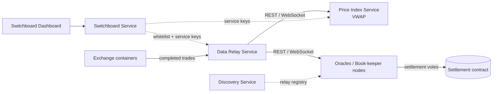

# Switchboard Service

> Go service that controls which exchanges, trade pairs and service keys can access a distributed market-data network. Echo · GORM/MySQL · JWT · Swagger.

<p>


</p>

The authorization hub of the platform. It keeps the whitelist of exchanges and trade pairs and issues the service keys that the data relays, discovery service and price-index service use to authenticate. It also includes a small admin UI (login and dashboard templates) for operators.

## Where it fits

Part of Alkemi's distributed market-data platform: a set of Go microservices that collect completed trades from exchange containers, relay them to oracles and a VWAP price index, and settle results on-chain.



## How it works

- `cmd/switch-board-service` is the entry point. It runs an Echo HTTP server with session middleware.
- `internal/app/switch-board-service/models` defines the `User`, `Exchange`, `TradePair` and `ServiceKey` models, persisted to MySQL through GORM with auto-migration.
- Endpoints use JWT and API-key auth, and Swagger docs are generated into `docs/swagger`.
- Logging goes through logrus, with error reporting to Sentry.

## Stack

Go, MySQL, Docker, Swagger, Sentry

## Running locally

```bash
docker-compose up -d database          # MySQL 5.7
cp configs/config.json.example configs/config.json
go run ./cmd/switch-board-service
```

## Credits

Built at Alkemi by Raynaldo Rivera and Lekan Adigun (2019), as part of the platform I founded and led.

---
<sub>Part of <a href="https://github.com/warbuxx87">Ryan Breen's</a> work · <a href="https://www.linkedin.com/in/breen-ryan/">LinkedIn</a></sub>
