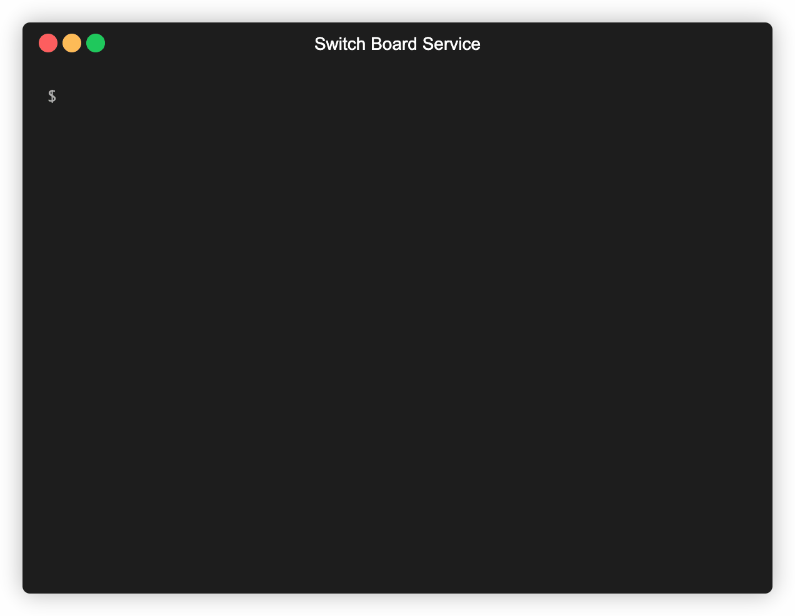

# Alkemi Switch Board Service

---

## Service Overview

The Switch Board Service maintains a running whitelist for every exchange on the alkemi network and the assets that are trading on it. The switchboard is operated by the alkemi team and is adjusted and modified as exchanges join the network. When an exchange joins the network for the first time the switch board will generate a “Auth Token” to be used by the containers when they first initiate connection with the Oracle Data Relay and the Index Service. Without a valid auth token the container will not be allowed to connect to the services and retrieve / submit data. This token will periodically be updated to protect against leakage.

After connection the container will begin to send price data and completed order data to the oracle data relay for every market it is configured to participate in. The Oracle data relay will retrieve this data and verify against the whitelist each asset the container is submitting data for. If the auth token isn’t allowed to send that instrument data then it will be ignored and a flag will be reported that the container is sending data it isn’t allowed to.

No automated mechanism will be in place to disable exchanges has this can cause unforeseen problems. These reports will need to be manually verified and acted on.

Once the data is verified allowed the oracle data relay passes the necessary information to the oracles and the index service

---

## Latest Deployment URLS
- [Switch Board Service API](https://switchboard-api.alkemi.tech/v1)

## Usage

### To Build

    go build bitbucket.org/project-alkemi/switch-board-service/cmd/switch-board-service

### To Run

    go run bitbucket.org/project-alkemi/switch-board-service/cmd/switch-board-service

### To Test

    go test bitbucket.org/project-alkemi/switch-board-service/test/switch-board-service

### To Clean

    go clean bitbucket.org/project-alkemi/switch-board-service/cmd/switch-board-service

### To Generate Documentation

    swag init -g cmd/switch-board-service/main.go --output docs/swagger/
